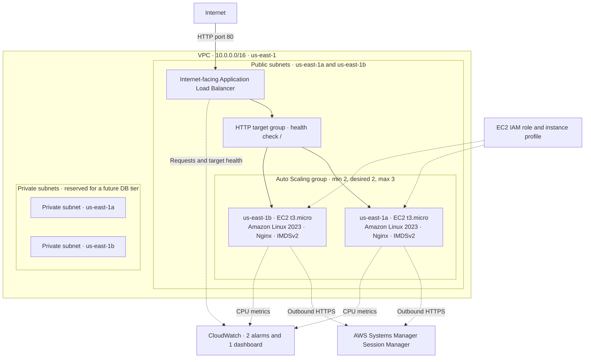
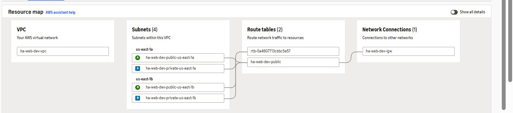
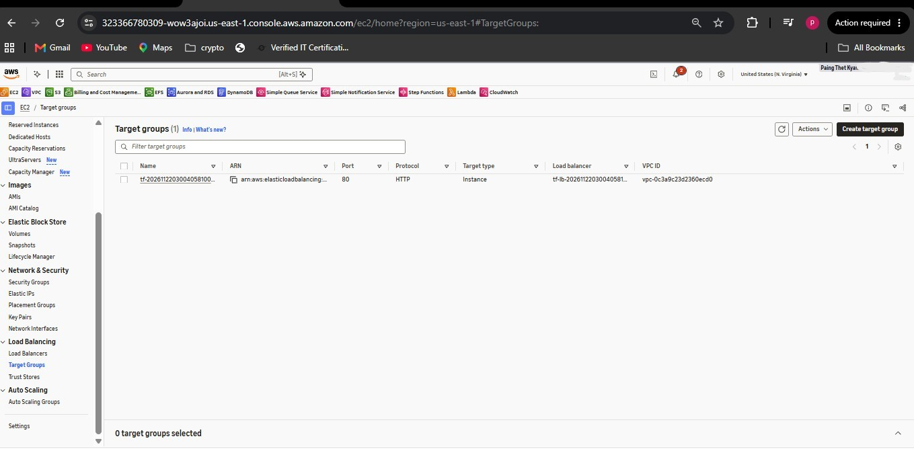
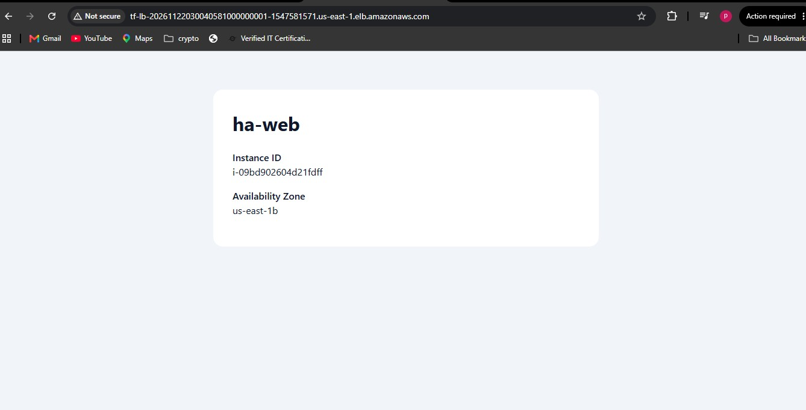
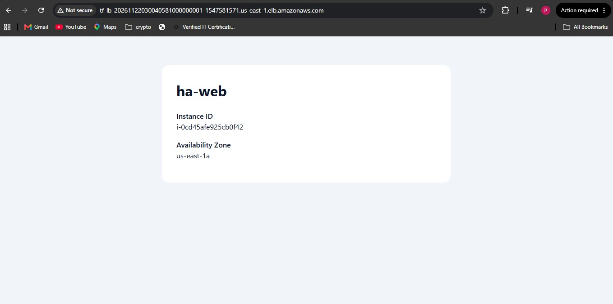
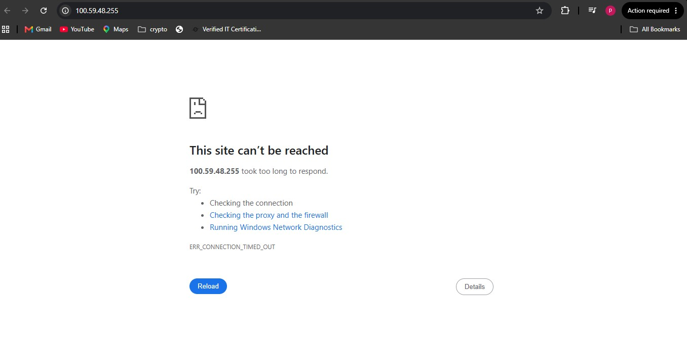
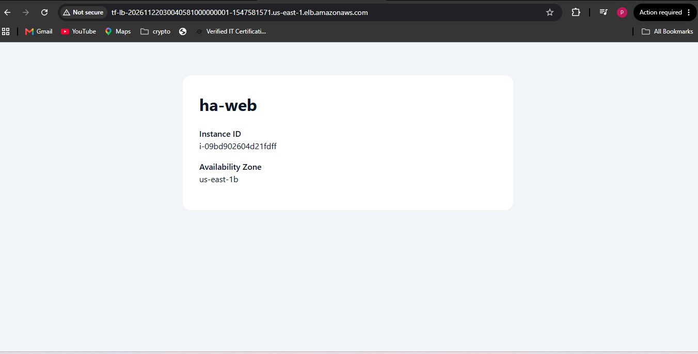
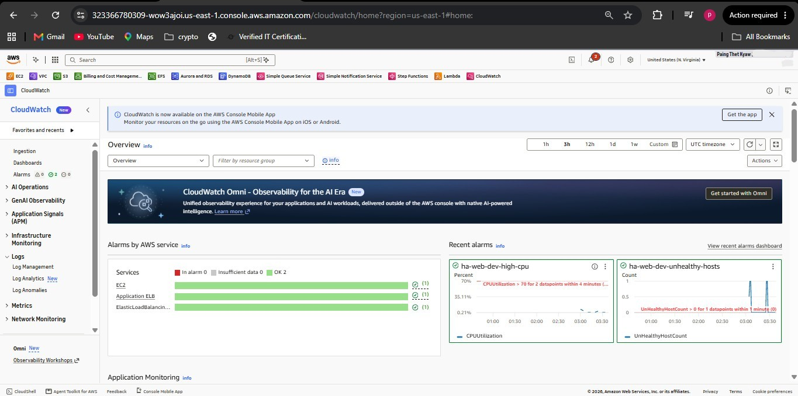
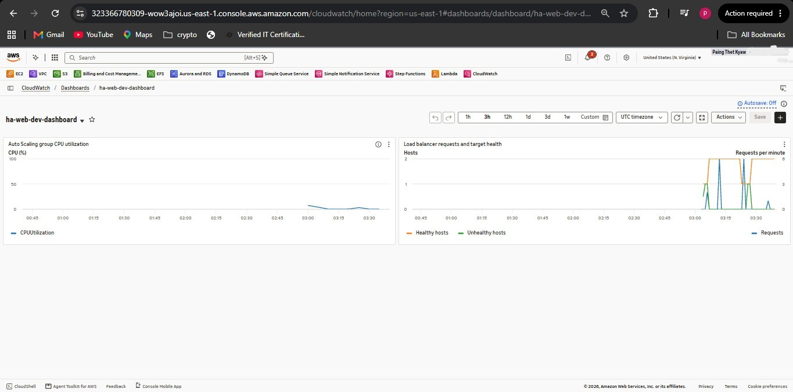

# Project 1 · AWS Highly Available Web Infrastructure Using Terraform

## Project Overview & Key Objectives

This project deploys a highly available Nginx web tier in AWS `us-east-1` using Terraform. An internet-facing Application Load Balancer (ALB) sends HTTP traffic to healthy EC2 instances across two Availability Zones. The web page displays the project name, instance ID, and Availability Zone so requests can be traced to the serving instance.

- Define a repeatable network and web tier with Terraform.
- Keep the application available during a single-instance failure using ALB health checks and Auto Scaling.
- Manage instances through AWS Systems Manager Session Manager with SSH closed.
- Monitor CPU utilization, request volume, and target health with CloudWatch.

## Architecture Diagram



The public subnets share a route table with a default route through the internet gateway. The private subnets use local VPC routing and are reserved for a future database tier.

## Security Best Practices Implemented

| Control | Implementation |
| --- | --- |
| Zero SSH | Port 22 is closed. Administrative sessions use AWS Systems Manager Session Manager with the EC2 instance profile and its `AmazonSSMManagedInstanceCore` policy. |
| Security group chaining | The public ALB accepts HTTP on port 80. The EC2 security group accepts HTTP on port 80 only from the ALB security group. |
| IMDSv2 | The launch template requires metadata tokens. The bootstrap script uses a token to retrieve the instance ID and Availability Zone. |
| Dedicated Terraform identity | Use a dedicated IAM user for Terraform with scoped permissions and credentials stored outside the repository. AWS account root access keys are excluded from the deployment workflow. |

## Verification & Failure Simulation Results

| Test | Observed result |
| --- | --- |
| Multi-AZ load balancing | Requests through the ALB returned pages identifying instances in both `us-east-1a` and `us-east-1b`. |
| Direct EC2 access | An HTTP request to an EC2 public IP timed out while the ALB URL remained reachable, demonstrating the security group restriction. |
| Auto Scaling self-healing | After one EC2 instance was terminated, the ASG detected the loss and automatically launched a replacement. The ALB continued serving requests through the remaining healthy instance, with zero downtime observed during the test. |

## Observability & Cost Optimization

- **CloudWatch alarms** track average ASG CPU utilization above 70% for two consecutive 120-second periods and average ALB `UnHealthyHostCount` above zero for one 60-second period.
- **CloudWatch dashboard** shows average EC2 CPU utilization for the ASG, total ALB requests, and healthy and unhealthy target counts.
- **CPU monitoring interval** matters for the alarm. EC2 basic monitoring publishes CPU data every five minutes, so the dashboard uses a 300-second period and the 120-second alarm can show `INSUFFICIENT_DATA`. [AWS EC2 monitoring documentation](https://docs.aws.amazon.com/AWSEC2/latest/UserGuide/manage-detailed-monitoring.html)
- **Cost controls** include `t3.micro` instances with standard CPU credits, a maximum of three instances, two alarms, and one dashboard. The design omits NAT Gateway and interface VPC endpoints. Check your account’s Free Tier eligibility and usage because EC2, storage, the ALB, and public IPv4 addresses can incur charges. Run `terraform destroy` after the demo to remove Terraform-managed resources. [AWS Free Tier](https://aws.amazon.com/free/) · [Elastic Load Balancing pricing](https://aws.amazon.com/elasticloadbalancing/pricing/)

## Screenshots

| Network and security | Availability and monitoring |
| --- | --- |
|  |  |
|  |  |
|  |  |
|  |  |

## How to Deploy & Destroy

Install Terraform 1.5 or later and configure AWS credentials for the dedicated Terraform IAM user. Run the commands from the directory containing this README and the Terraform files. The configuration defaults to `us-east-1`.

```sh
terraform init
terraform plan
```

Review the plan, then deploy and print the application URL.

```sh
terraform apply
terraform output -raw alb_url
```

Open the URL once the target group reports healthy instances. Check the instance ID and Availability Zone displayed on the page.

When the demo is finished, review and confirm the teardown from the same directory.

```sh
terraform destroy
```
